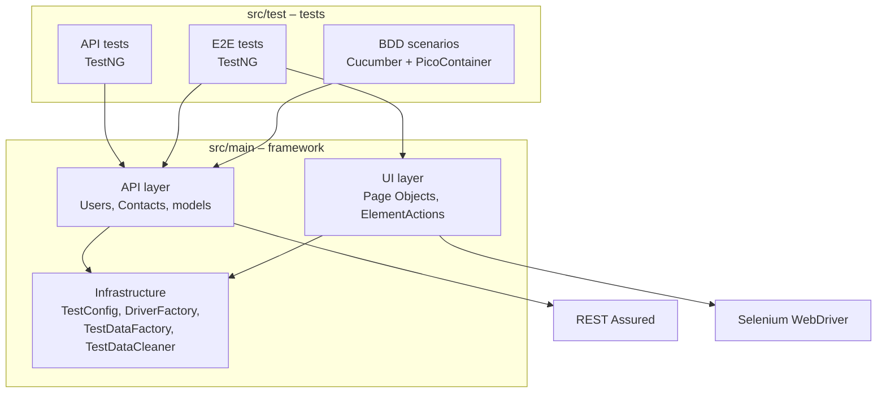

# Selenium E2E

[](https://github.com/piotrwaligora/selenium-e2e/actions/workflows/tests.yml)
[](https://piotrwaligora.github.io/selenium-e2e/)

- **CI pipeline:** [GitHub Actions runs](https://github.com/piotrwaligora/selenium-e2e/actions/workflows/tests.yml)
- **Latest test report:** [Allure report on GitHub Pages](https://piotrwaligora.github.io/selenium-e2e/) (updated after every merge to `main` and daily)

API and UI test automation framework in Java. It shows a layered test architecture,
design patterns, BDD, reporting and CI on a real application:
the [Contact List App](https://thinking-tester-contact-list.herokuapp.com/)
([REST API docs](https://documenter.getpostman.com/view/4012288/TzK2bEa8)).

## Highlights

- **Layered design** – framework code in `src/main`, tests in `src/test`; tests never build HTTP requests or locate elements themselves
- **REST API layer** – thin API classes per resource, request/response models as Java records
- **UI layer** – Page Object Model on Selenium 4 with an explicit-wait wrapper built on `FluentWait`
- **End-to-end flows** – data created through the API verified in the UI, and data entered in the UI verified through the API
- **BDD** – Cucumber scenarios with PicoContainer dependency injection, `Scenario Outline`, `Background` and data tables
- **Test isolation** – every test registers its own user through the API and removes it afterwards, also when the test fails
- **Reporting** – Allure with steps, HTTP request/response logs and screenshots of failed UI tests
- **Retry** – optional, configurable retry of failed tests with failed attempts kept in the report
- **CI** – GitHub Actions on every push and pull request, reports uploaded as artifacts

## Tech stack

| Area | Technology |
|---|---|
| Language | Java 25 |
| Build | Maven |
| Test runner | TestNG |
| API testing | REST Assured, Jackson |
| UI automation | Selenium 4 (Selenium Manager), Chrome GUI / headless |
| BDD | Cucumber 8, Gherkin, PicoContainer |
| Assertions | AssertJ, SoftAssertions |
| Reporting | Allure (TestNG + Cucumber + REST Assured) |
| CI/CD | GitHub Actions |

## Architecture



### Design patterns and decisions

| Pattern / decision | Where | Why |
|---|---|---|
| Page Object Model | `ui/pages` | Locators and UI operations are separated from test logic |
| Factory | `DriverFactory`, `Browser` | Creates the configured browser; a new browser is one enum value and one `switch` branch |
| Wrapper over `FluentWait` | `ElementActions` | Every action waits until the element is ready; no implicit waits, no `Thread.sleep` |
| Template method (base test classes) | `BaseApiTest`, `BaseUiTest` | Shared setup, cleanup and reusable steps; UI tests extend API tests to reuse API setup |
| Dependency injection | Cucumber + PicoContainer | A fresh `TestContext` per scenario, shared by hooks and step definitions |
| Test data builder | `TestDataFactory` | Unique data (UUID-based) for every test, so tests never share state |

**Why a custom wait wrapper and not Selenide or Playwright?**
Selenide and Playwright offer auto-waiting out of the box and were considered.
This project intentionally keeps plain Selenium to show how synchronization, driver
creation and page objects work under the hood. `ElementActions` stays small:
`waitFor(By)` returns the located element, so each action finds the element once
and avoids stale element issues.

**Why Cucumber runs on TestNG?**
All tests run on a single engine with one configuration, one listener set and one report.
The TestNG integration is deprecated in Cucumber 8 but fully functional; moving to the
JUnit Platform would be the path for a future Cucumber upgrade.

## Project structure

```
src/main/java/io/github/piotrwaligora/e2e/
├── api/
│   ├── client/          BaseApi, Users, Contacts – REST API clients
│   └── model/           request/response records
├── config/              TestConfig – properties with -D overrides
├── data/                TestDataFactory, TestDataCleaner
└── ui/
    ├── driver/          DriverFactory, Browser
    ├── pages/           Page Objects
    └── ElementActions   explicit-wait wrapper
src/main/resources/config.properties

src/test/java/io/github/piotrwaligora/e2e/
├── api/                 BaseApiTest, UserApiTest, ContactApiTest
├── ui/                  BaseUiTest, ContactE2ETest
├── bdd/                 context, hooks, steps, runners
└── listeners/           console progress, retry
src/test/resources/
├── features/            Gherkin feature files
├── testng.xml           suite: API, UI, BDD
└── allure.properties
```

## Test coverage

| Suite | Tests | Scope |
|---|---|---|
| API | 14 | Registration, login, logout, profile, user deletion, contact CRUD (POST, GET, PUT, PATCH, DELETE), validation and authorization errors |
| UI (E2E) | 2 | Contact created through the API shown in the UI; contact added in the UI returned by the API |
| BDD | 12 | User registration (Scenario Outline with 10 examples), adding and updating contacts |

Tests read like test cases: actions (`createContactViaApi`, `loginViaUi`) and checks
(`verifyContactData`, `verifyContactIsListed`) are named methods, shown as steps in the Allure report.

## Getting started

### Prerequisites

- JDK 25
- Maven 3.9+
- Google Chrome (the driver is downloaded automatically by Selenium Manager)

### Running tests

```bash
# All tests (API, UI, BDD)
mvn clean test

# Headless browser
mvn clean test -Dheadless=true

# Visible browser
mvn clean test -Dheadless=false

# Retry failed tests once
mvn clean test -Dretry.count=1

# A single test class or the Cucumber runner
mvn clean test -Dtest=ContactE2ETest
mvn clean test -Dtest=CucumberTestRunner
```

> **PowerShell:** quote properties that contain a dot, e.g. `"-Dretry.count=1"`,
> otherwise PowerShell splits the argument.

The console shows the progress of every test:

```
===== API =====
[API 1/14] STARTED ContactApiTest.shouldCreateContact
[API 1/14] PASSED  ContactApiTest.shouldCreateContact (1.2 s)
...
[BDD 3/12] STARTED Scenario: Register a new user - typical user
```

### Configuration

Defaults are in `src/main/resources/config.properties`; every property can be overridden with `-D`.

| Property | Default | Description |
|---|---|---|
| `base.url` | `https://thinking-tester-contact-list.herokuapp.com` | Application under test (API and UI) |
| `browser` | `chrome` | Browser created by `DriverFactory` |
| `headless` | `false` | Run the browser without a window |
| `ui.timeout.seconds` | `10` | Maximum wait for an element |
| `ui.polling.millis` | `250` | Polling interval of the wait |
| `retry.count` | `0` | Retries of a failed test: `0` (disabled) or `1` |

## Reports

Tests write Allure results to `target/allure-results`.

```bash
# Generate the report and open it in the browser
mvn allure:serve

# Run tests and open the report, also when some tests fail
mvn clean test allure:serve -Dmaven.test.failure.ignore=true

# Generate a static report into target/site/allure-maven-plugin
mvn allure:report
```

The report contains:

- test steps of TestNG tests and Gherkin steps of Cucumber scenarios
- every HTTP request and response (sensitive headers such as `Authorization` are masked)
- a screenshot and the current URL of every failed UI test, taken before the browser is closed
- failed attempts of retried tests in the **Retries** tab

## Continuous integration

The [GitHub Actions workflow](.github/workflows/tests.yml) runs on every push and on pull requests to `main`:

1. sets up Java 25 with Maven dependency caching
2. runs all tests in headless Chrome with one retry (the tested application is a public demo app)
3. generates the Allure report, also when tests fail
4. uploads artifacts: `allure-report`, `allure-results`, `screenshots` and `surefire-reports`
5. on `main`, publishes the Allure report to [GitHub Pages](https://piotrwaligora.github.io/selenium-e2e/), also when tests fail

Every run summary links to the latest report. The report of a branch or pull request run
is available as the `allure-report` artifact.

## Test data

Every test and scenario registers a unique user through the API and deletes the user
together with its contacts after the test, also on failure. The cleanup logs in again before
deleting, because logging out invalidates all tokens of a user. The application database is
public and periodically purged, so no data is left behind between runs.
